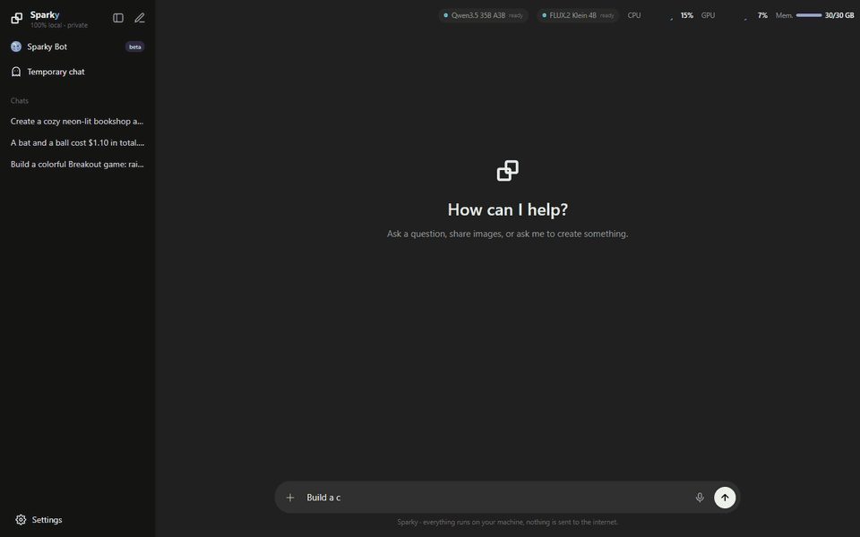
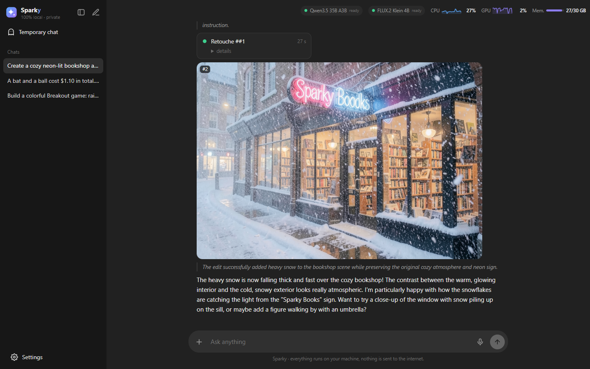
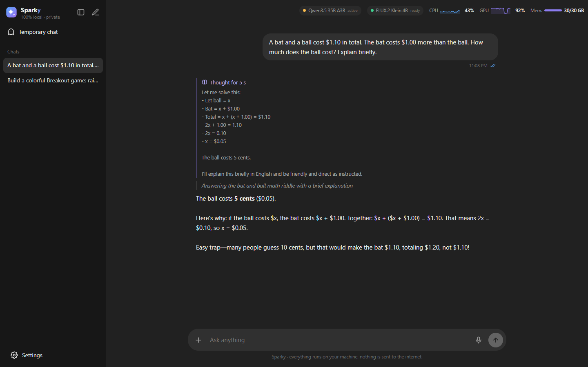
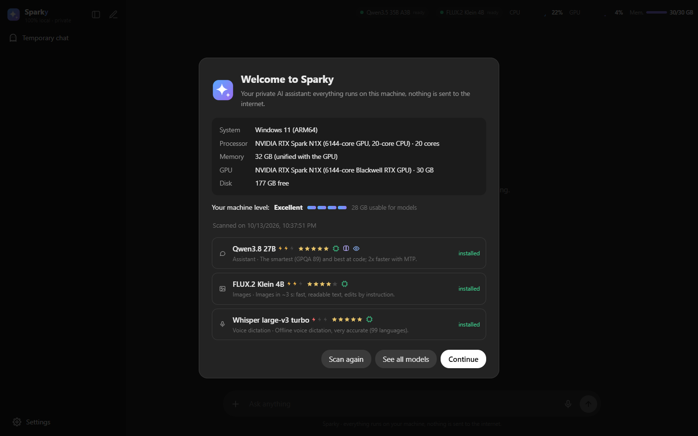
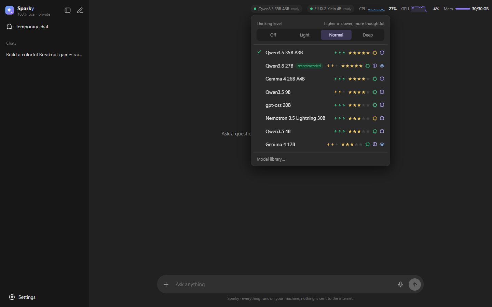
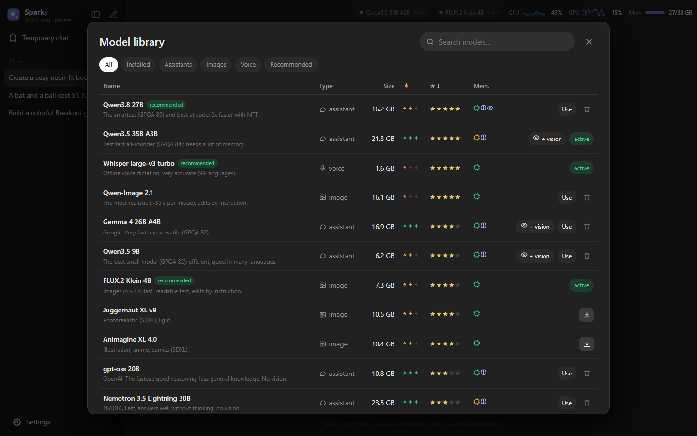
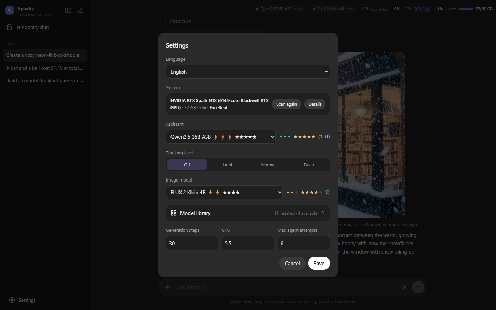
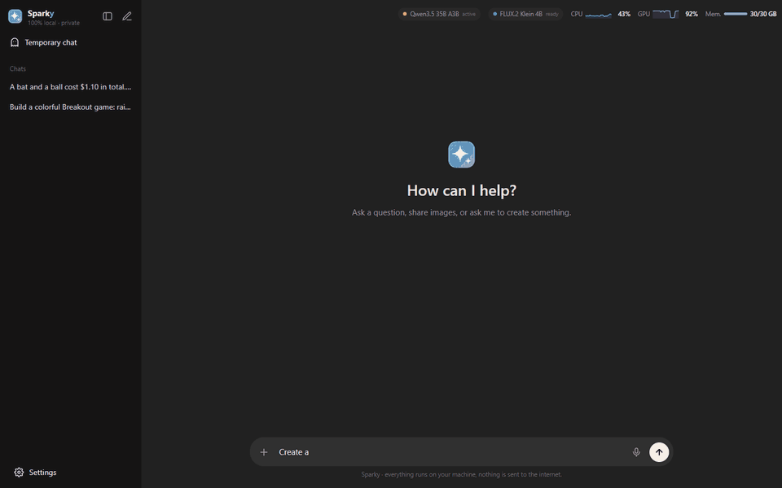
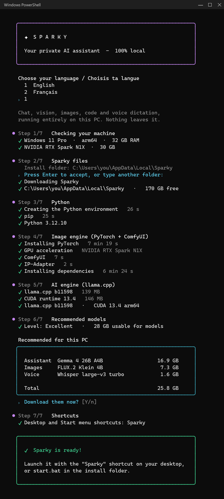
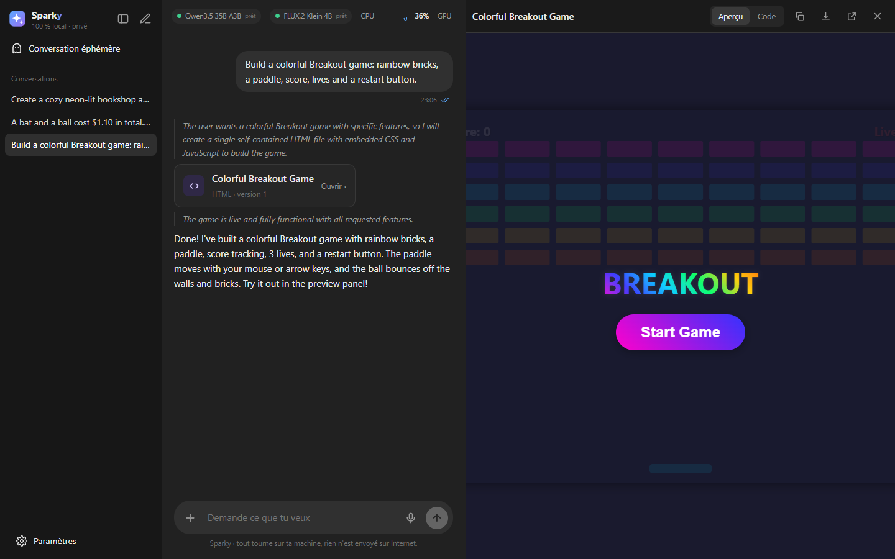

<p align="center"></p>

<h1 align="center">Sparky</h1>

<p align="center"><b>Your private AI assistant. 100% local.</b><br>
Chat, see images, generate and edit pictures, build apps and dictate by voice —<br>
everything runs on your own PC. Nothing is sent to the internet.</p>

<p align="center">
  
  
  
  
  
</p>

<p align="center"></p>

---

## What it does

- **Chat like ChatGPT, offline** — conversation history, plus **temporary chats** that are never saved.
- **Code & apps panel** — ask for a game, a web page, a tool or a script: it is written live in a panel next to the chat, with a **running preview**, the code, versions, copy and download.
- **Images** — generate and edit pictures by simply asking ("make it snow", "remove the bottle"). The agent checks its own result and retries when needed.
- **Vision** — drop photos, screenshots or scanned documents: the assistant sees and analyses them.
- **Voice dictation, offline** — click the mic, talk, stop: Whisper turns your voice into text right in the input box.
- **Adjustable thinking** — Off, Light, Normal or Deep, right from the model menu.
- **System scan** — at install time (and anytime from *Settings > System*) Sparky checks your GPU, memory and disk, then **recommends the models that fit your machine**.
- **Model library** — one-click installs with resumable downloads, and speed / quality / memory indicators *for your hardware*.
- **Only official models** — Qwen, Gemma, gpt-oss, Nemotron, FLUX.2, Whisper… "uncensored", "abliterated" or NSFW variants are excluded from the catalog and from the Hugging Face search.
- **English or French** — chosen during install, switchable in the settings.

## Screenshots

| | |
|---|---|
| <br>**Images** — generate, then edit by instruction | <br>**Thinking** — see how the model reasoned |
| <br>**First launch** — system scan and recommended models | <br>**Model menu** — switch models, pick a thinking level |
| <br>**Model library** — speed, quality and memory for your PC | <br>**Settings** — language, system, models |

<p align="center"></p>

<p align="center"><br><i>Offline voice dictation: live level bars, then the text lands in the input box.</i></p>

## Install (Windows 10/11)

**One line**, in PowerShell:

```powershell
irm https://raw.githubusercontent.com/anisayari/sparky/main/install.ps1 | iex
```

**Or** download the project (*Code > Download ZIP*), unzip it and double-click `install.bat`.

The installer walks you through 7 simple steps:

1. choose your language (English / Français) and check your machine,
2. pick the install folder (default `%LOCALAPPDATA%\Sparky`),
3. install Python 3.12 if needed (via winget),
4. install PyTorch for your GPU and the image engine [ComfyUI](https://github.com/comfyanonymous/ComfyUI),
5. install the AI engine [llama.cpp](https://github.com/ggml-org/llama.cpp) (CUDA build for NVIDIA GPUs, x64 or ARM64),
6. scan your hardware, show the recommended models and offer to download them,
7. create a **Sparky** shortcut on the desktop and in the Start menu.

<p align="center"></p>

Then double-click the shortcut (or `start.bat`): Sparky opens at <http://127.0.0.1:7860>. To stop everything: `stop.bat`.

### Which machine?

| Machine | Runs well |
|---|---|
| NVIDIA GPU 24 GB+ or 32 GB+ unified memory | 27–35B assistants, Qwen-Image 2.1 |
| NVIDIA GPU 12–16 GB | 9–20B assistants, FLUX.2 Klein |
| NVIDIA GPU 6–8 GB | 4–9B assistants, FLUX.2 Klein (slower) |
| No NVIDIA GPU | small assistants (4B) on the CPU, no image generation |

The system scan picks automatically among these.

## Models

Speeds measured on an RTX Spark N1X (Q4, full power); Sparky adapts them to your GPU.

| Assistant | Size | Speed | GPQA (published) | Vision | Best for |
|---|---|---|---|---|---|
| gpt-oss 20B | 11 GB | 83 tok/s | 71.5 | | fastest |
| Qwen3.5 35B A3B | 21 GB | 74 tok/s | 84.2 | ✓ | best fast all-rounder |
| Nemotron 3.5 Lightning 30B | 24 GB | 74 tok/s | 75.4 | | fast without thinking |
| Qwen3.5 4B | 3 GB | 66 tok/s | 76.2 | ✓ | tiny, even without a GPU |
| Gemma 4 26B A4B | 17 GB | 62 tok/s | 82.3 | ✓ | fast and versatile |
| Qwen3.5 9B | 6 GB | 34 tok/s | 81.7 | ✓ | best small model |
| Gemma 4 12B | 7 GB | 34 tok/s | 78.8 | ✓ | light |
| Qwen3.8 27B | 16 GB | 16 (33 with MTP) | 89.2 | ✓ | smartest, best at code |
| Gemma 4 E4B | 6 GB | – | – | ✓ | small machines |

All of them can think before answering (adjustable level). Vision can be added in one click when it is missing.

| Images | Size | Time per image | Style |
|---|---|---|---|
| FLUX.2 Klein 4B | 7 GB | ~3 s | photo, readable text, edits by instruction |
| Qwen-Image 2.1 | 16 GB | ~35 s | most realistic, edits by instruction |
| Juggernaut XL v9 | 10 GB* | ~15 s | photo (SDXL) |
| Animagine XL 4.0 | 10 GB* | ~15 s | illustration (SDXL) |

| Voice | Size | Note |
|---|---|---|
| Whisper large-v3 turbo | 1.6 GB | very accurate, 99 languages (GPU) |
| Whisper base | 0.3 GB | light, for machines without a GPU |

\* includes the IP-Adapter files (≈ 4 GB, shared by all SDXL models) used to reuse a character or a style.

Every model keeps its own license (Apache 2.0, Gemma Terms of Use, NVIDIA Open Model License, etc.): check its Hugging Face page before any commercial use.

## Existing installation (ComfyUI / llama.cpp already installed)

Create a `config.json` file at the project root to reuse your folders:

```json
{
  "python": "D:\\ai\\venv\\Scripts\\python.exe",
  "comfy_dir": "D:\\ai\\ComfyUI",
  "llama_server": "D:\\ai\\llama\\llama-server.exe",
  "llm_dir": "D:\\ai\\models",
  "mmproj_dir": "D:\\ai\\mmproj"
}
```

Other keys: `voice_dir`, `data_dir`, `app_port` (7860), `llm_port` (8080), `comfy_port` (8188). The `SPARKY_CONFIG` environment variable can point to another config file.

## Command line

```powershell
runtime\venv\Scripts\python.exe app\syscheck.py                  # system scan (add --lang=fr for French)
runtime\venv\Scripts\python.exe app\models_cli.py --list         # catalog
runtime\venv\Scripts\python.exe app\models_cli.py --recommended  # install the recommended models
runtime\venv\Scripts\python.exe app\models_cli.py qwen359        # install one model
```

## Update / uninstall

- **Update**: run the install command again (or `git pull` in the install folder).
- **Uninstall**: `stop.bat`, then delete the install folder (`%LOCALAPPDATA%\Sparky` by default) and the shortcuts.

## Privacy

Everything runs on your machine: conversations, images and models stay in the install folder (`data\`, `models\`). The only outgoing connections download the tools and models (GitHub, PyPI, Hugging Face) and search the model library.

## En français

L'interface et l'installeur existent aussi en français : choisis *Français* au début de l'installation, ou change la langue dans *Paramètres*.

<p align="center"></p>

## Project layout

```
app/
  server.py     web server + model management
  harness.py    agent: assistant <-> image tools loop, artifacts
  catalog.py    catalog, downloads, indicators
  syscheck.py   system scan and recommendations
  stt.py        offline voice dictation (Whisper)
  index.html    interface (English / French)
install.ps1     step-by-step installer
start.ps1 / stop.ps1
docs/           screenshots and demos
```

## License

Code under the [MIT](LICENSE) license. ComfyUI (GPL-3.0) and llama.cpp (MIT) are downloaded separately during install.
